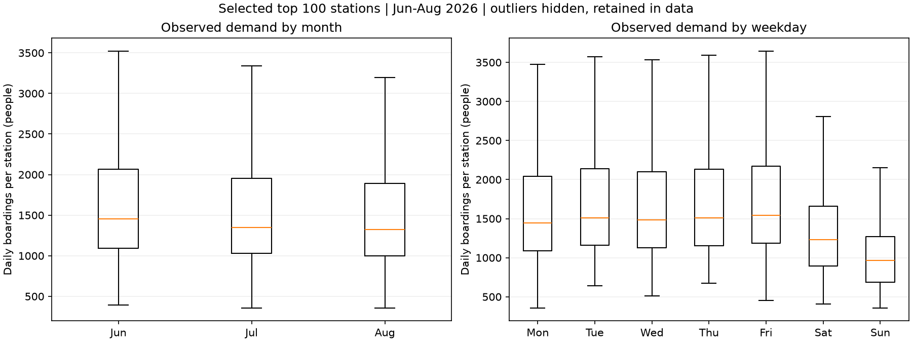
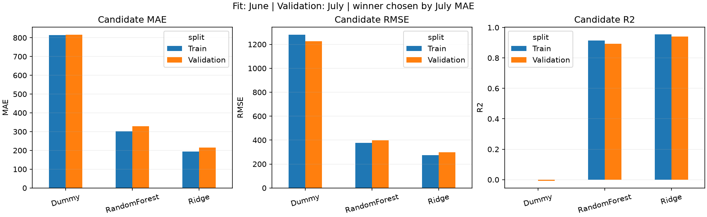
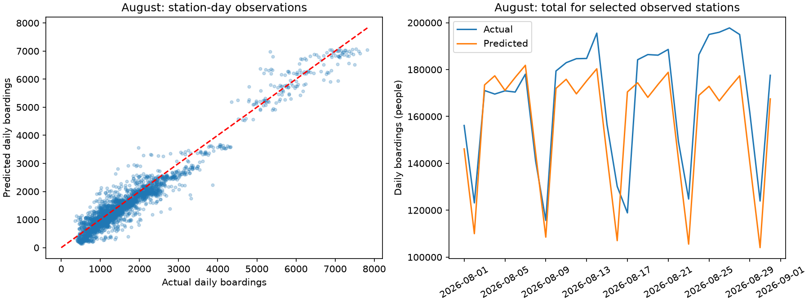

# 수원시 버스 정류장별 일일 승차 수요 예측 및 시각화 서비스

정류소ID와 날짜로 **정류소별 하루 승차 인원**을 예측하는 Scikit-learn·Streamlit MVP입니다. 2026년 6~7월 이용량 기준 상위 100개 정류소만 대상으로 합니다. 실제 학습·노트북 전체 실행·앱 동작 검증을 완료했습니다(2026-10-29).

## 설치·실행

Windows PowerShell, 프로젝트 루트 기준입니다. Python **3.12.6**에서 검증했으며, 저장 모델의 재현을 위해 패키지 버전을 requirements에 고정했습니다.

```powershell
cd D:\kang\workspace\suwon-bus-demand-ml
python -m venv .venv
.\.venv\Scripts\python.exe -m pip install -r requirements.txt
.\.venv\Scripts\python.exe -m streamlit run app.py
```

이 작업에서는 `.venv` 설치가 끝났으므로 마지막 명령으로 바로 앱을 실행할 수 있습니다. 앱 실행은 로컬 CSV·joblib·JSON만 사용합니다. 기본 브라우저가 열리지 않으면 터미널의 로컬 주소에 접속하세요. 종료는 `Ctrl+C`입니다. 네트워크는 최초 패키지 설치에만 필요합니다.

학습 결과를 재생성하려면 다음 명령으로 노트북의 모든 셀을 순서대로 실행합니다. `execute_notebook.py`는 현재 Python의 커널을 사용하므로 별도 Jupyter 서버 설치가 필요 없습니다. 노트북·models·outputs의 생성 산출물을 갱신하며 원본 CSV는 변경하지 않습니다. 재학습 이후 README·보고서의 고정 표도 새 결과와 대조해야 합니다.

```powershell
.\.venv\Scripts\python.exe execute_notebook.py
.\.venv\Scripts\python.exe verify.py
```

VS Code/Jupyter에서 노트북을 열 경우 `.venv` Python을 커널로 선택하고 위에서부터 실행할 수도 있습니다. 일반 앱 실행에는 노트북 재학습이 필요 없습니다. `train.py`는 joblib 내부의 피처 함수 정의를 제공하므로 앱·모델과 함께 유지하세요.

## 실제 데이터와 품질

출처는 제공 자료에 명시된 **경기데이터드림 ‘경기도 정류소 별 승하차 인원 집계’**, 수원시 2026년 6~8월입니다. 본 작업은 제공 CSV를 분석했으며 원 사이트 다운로드·수집 이력·이용 조건을 별도로 재확인하지 않았습니다. 출처의 상세 데이터셋 URL·수집일·이용 조건은 제출 전 사용자가 보완할 사항입니다.

| 항목 | 실측 결과 |
|---|---:|
| 기간 | 2026-06-01 ~ 2026-08-31, 92일 |
| 원본 행·컬럼 | 129,049행·9개 |
| 고유 정류소ID | 1,435개 |
| 관할관청 | 모든 행 수원시 |
| 결측치 / 정류소·날짜 중복 / 음수 인원 | 모두 0건 |
| 실제 승차합계 0명 관측 | 5,481행, 유지 |
| 전체 1,435개×92일 대비 미관측 조합 | 2,971개, 0으로 채우지 않음 |

컬럼: `승하차일자, 관할관청, 정류소ID, 정류소번호, 정류소명, 승차합계, 초승, 환승, 하차`. 정류소ID·번호는 문자열로 읽어 번호의 선행 0을 보존합니다. 예상 데이터 규모와 실제 검증 결과가 일치합니다.

원본 SHA-256(학습 전후·검증 후 동일):

```text
67eab89c329abbfe75421c9b25e2aec0dadd9dfc699b2096dd2bf0da4ae4811b
```

## 대상 선정과 누수 방지

6~7월에 **55일 이상** 관측된 정류소의 6~7월 `승차합계` 합을 내림차순으로 정렬해 상위 **100개**를 선정합니다. 동률은 ID 오름차순입니다. 실제 선정된 100개는 모두 61일 관측되었고, 8월도 모두 31일 관측되었습니다. 8월은 순위·대상·메타데이터 선정에 사용하지 않았습니다. 범주 수와 학습 시간을 줄여 빠르게 재현하는 MVP이며 수원시 전체 서비스를 의미하지 않습니다.

목표는 `승차합계`입니다. 입력은 **정류소ID와 날짜만** 받고, 날짜에서 요일·주말 여부·월·일을 만듭니다. 정류소ID·요일은 `OneHotEncoder(handle_unknown='ignore')`, 나머지는 `StandardScaler`로 처리합니다. ID의 크기를 연속값으로 해석하지 않습니다. `FunctionTransformer → ColumnTransformer → 모델` Pipeline을 저장하므로 학습·앱의 전처리가 같습니다. 초승·환승·하차·당일 승차합계 및 다른 결과성 변수는 입력에 사용하지 않습니다. 정류소명·번호는 화면 표시용입니다.

학습은 **6월 3,000행**, 검증은 **7월 3,100행**, 최종 테스트는 **8월 3,100행**입니다. 무작위 분할을 하지 않습니다. 후보마다 6월만 fit하고 **7월 MAE 최소** 후보를 정한 뒤, 해당 모델을 6~7월 **6,100행**에 재학습합니다. 확정한 모델의 8월 예측을 한 번 생성해 평가·그림·표가 공유합니다. 앱도 테스트에 사용한 같은 6~7월 학습 모델을 사용하며 8월로 다시 학습하지 않습니다.

대상 집합은 지시된 기준대로 6~7월로 선정했으므로 **7월 검증은 대상 선정과 완전히 독립적이지 않습니다.** 8월 테스트는 대상 선정과 모델 선택 모두에 사용하지 않았습니다.

## 실측 모델 성능

모든 MAE·RMSE 단위는 **명/정류소·하루**, R²는 무단위입니다. 후보 Train·Validation은 6월 학습 모델의 결과이며, Final training·Test는 6~7월 재학습 모델의 결과입니다.

| 모델 | 평가 구간 | MAE | RMSE | R² |
|---|---|---:|---:|---:|
| Dummy(mean) | Train: 6월 | 814.095 | 1279.195 | 0.0000 |
| Dummy(mean) | Validation: 7월 | 815.271 | 1225.172 | -0.0065 |
| Ridge(alpha=1) | Train: 6월 | 193.889 | 274.989 | 0.9538 |
| **Ridge(alpha=1)** | **Validation: 7월** | **215.933** | **297.517** | **0.9406** |
| RandomForest | Train: 6월 | 302.480 | 376.343 | 0.9134 |
| RandomForest | Validation: 7월 | 329.460 | 398.001 | 0.8938 |
| 최종 Ridge | Final training: 6~7월 | 182.972 | 269.904 | 0.9535 |
| **최종 Ridge** | **Test: 8월** | **218.860** | **299.136** | **0.9387** |

RF는 `n_estimators=60, max_depth=20, min_samples_leaf=3, random_state=42, n_jobs=2`로 고정했습니다. 시간·메모리·모델 크기와 과적합을 제한하기 위한 MVP 선택이며 GridSearch는 하지 않았습니다. 이 결과는 이 설정에서의 비교이며 다른 RF 설정까지 일반화하지 않습니다. 최종 모델은 **2,909 bytes**입니다.

인원이 음수가 되지 않도록 평가·앱에서 예측을 0 이상으로 제한합니다. 평가에서는 반올림하지 않고, 앱 화면에서만 정수로 반올림합니다. 원시 `pipeline.predict` 대신 동일한 후처리가 있는 `train.predict_counts`를 사용하세요. 지표 원본은 `outputs/metrics.json`입니다. R²를 정확도 93.87%로 해석하면 안 됩니다.

## 앱과 결과 그림

정류소명·정류소번호·ID를 함께 표시하는 100개 선택지, 날짜 선택, 예측 버튼, 예상 일일 승차 인원, 과거 일별·요일별 패턴, 최종 테스트 MAE·RMSE·R²를 제공합니다. 학습 마지막 날짜(2026-07-31) 이후에는 제한적 추정 안내를 표시합니다. 6~8월은 전체 관측 기간이고 모델 학습은 6~7월입니다. 과거 패턴 차트의 8월 관측은 설명용이며 예측 입력이 아닙니다. 날짜 UI는 관측 시작일~2027-08-31로 제한했으나 그 범위의 장기 성능을 보장하지 않습니다.







## 파일

| 경로 | 내용 |
|---|---|
| `app.py` | Streamlit 앱 |
| `train.py` | 품질 검증·피처·학습·저장 공통 함수 |
| `suwon_bus_demand_ml.ipynb` | 설명·실행 결과·그림을 포함한 분석 노트북 |
| `execute_notebook.py`, `verify.py` | 전체 재실행·실제 검증 |
| `requirements.txt`, `.gitignore` | 재현 환경·Git 제외 설정 |
| `models/demand_pipeline.joblib` | 확정한 Ridge Pipeline |
| `outputs/metrics.json`, `model_comparison.csv` | 실측 지표 |
| `outputs/stations.csv`, `history.csv` | 대상 및 앱의 과거 관측 |
| `outputs/test_predictions.csv`, `figures/` | 최종 예측 표·보고서 그림 3개 |
| `outputs/validation.json` | 실제 검증 결과 |
| `docs/report_draft.md`, `reference_review.md` | 보고서 초안·참고 검토 기록 |

## 실제 실행 검증

분석 노트북 **코드 6개 셀 전체 실행**, 오류 0개를 확인했습니다. `verify.py`의 **6개 검사 통과**: 원본·관측 보존, 8월 변조 시 선정 불변, 결과성 컬럼 변조 시 피처·예측 불변, 저장 모델의 100개 정류소 미래 예측 및 미지 범주 처리, 노트북·시간 분할·선정 일관성, 앱 import 및 날짜·정류소 변경·예측 버튼 동작입니다. AppTest로 기능을 확인했으며 브라우저 화면 캡처는 생성하지 않았습니다.

실제 `streamlit run` 서버의 `/_stcore/health` 응답 `ok` 및 루트 페이지 HTTP 200을 확인한 뒤 검증 프로세스를 종료했습니다. 설치 때 네트워크 권한 제한이 있었고, 승인 후 프로젝트 `.venv`에 설치했습니다. 상세 결과는 `outputs/validation.json`에 있습니다.

## 한계와 제출 전 남은 작업

여름 3개월 중 학습은 2개월뿐입니다. 날씨·공휴일·방학·행사·노선·배차 변화는 반영하지 않습니다. 날짜만으로 다른 계절·연도의 수요를 안정적으로 추정할 수 없습니다. 높은 전체 R²에는 정류소 간 수요 수준 차이가 반영되므로 개별 정류소의 날짜별 변동을 그만큼 정확히 맞춘다는 뜻은 아닙니다. 8월 일부 고수요 관측과 일별 합계의 과소추정이 남아 있습니다. 개별 예측구간이나 실측 미래 성능을 제공하지 않습니다.

HWP 양식은 직접 파싱하지 못했으므로 세부 서식 일치를 보장하지 않습니다. 제공 지시문에 맞춘 Markdown 보고서 초안과 실제 그림을 만들었습니다. **제출 전 사용자가 HWP에 옮겨 서식·인적사항을 완성하고, 실제 앱 화면을 캡처해 삽입하고, 원 데이터 상세 출처·이용 조건을 확인**해야 합니다. Cloud 배포·발표 자료는 이번 범위에 없습니다.

GitHub 연결·git init·브랜치 변경·Commit·Push는 수행하지 않았습니다. SourceTree에서 변경 파일을 검토한 뒤 Commit할 수 있는 로컬 상태입니다. `.venv/`, `tmp/`, `reference_materials/` 등은 제외하고 원본 CSV·노트북·앱·공통 코드·문서·작은 모델·outputs를 포함할 수 있도록 했습니다. 이미 추적 중인 참고자료는 `.gitignore`만으로 제외되지 않으므로 SourceTree의 스테이징 목록도 확인하세요.
